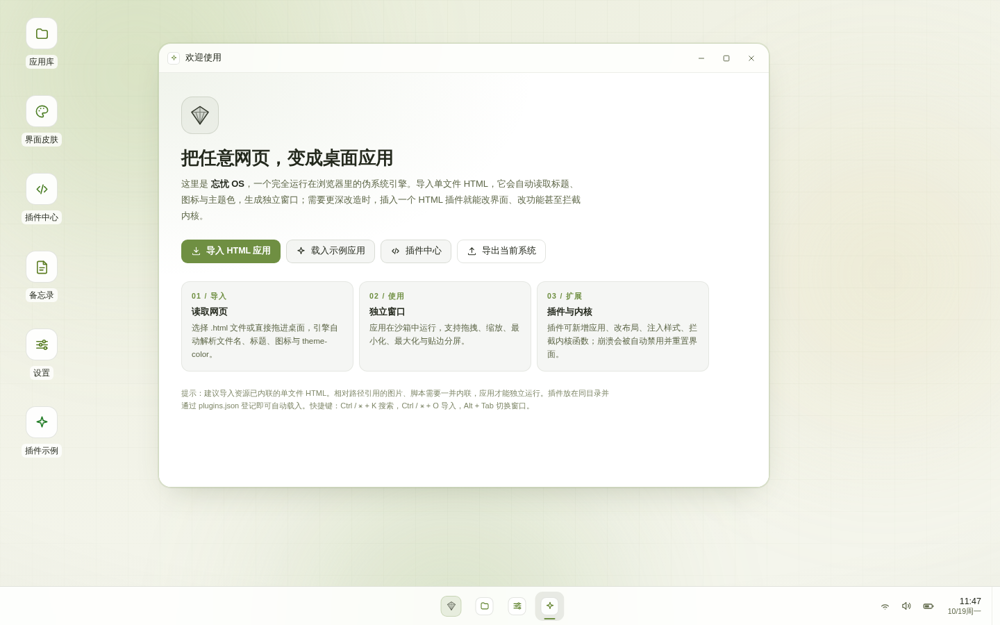
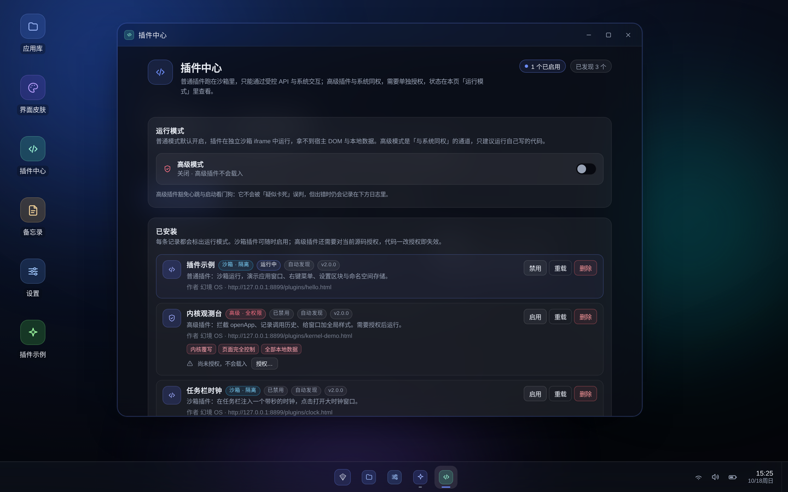
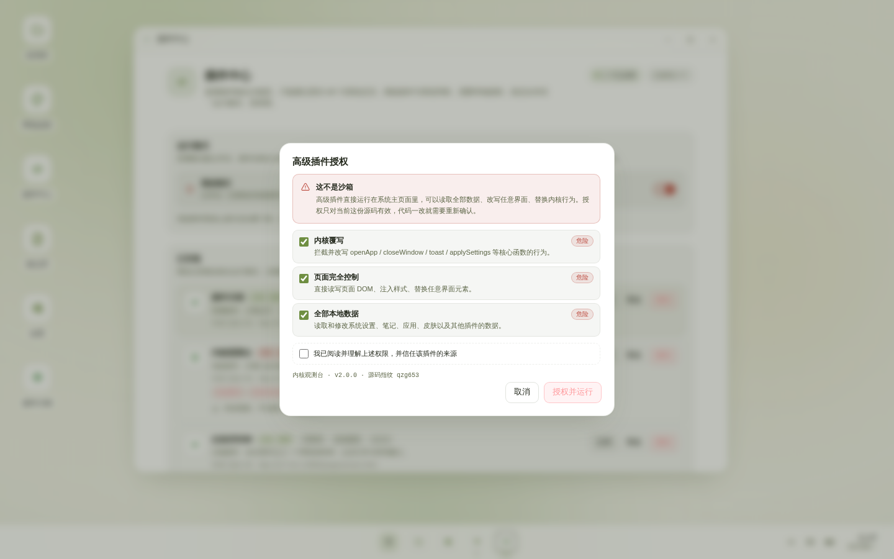
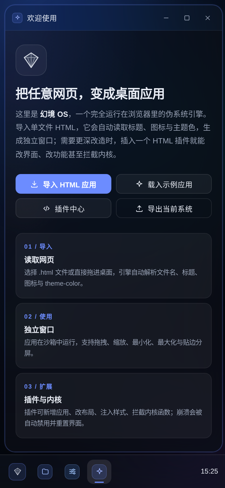

<div align="center">

# 忘忧 OS · Wangyou OS

**把任意网页，变成桌面应用。**

一个单文件 HTML，零依赖、离线可用，双击就得到一个能开窗、能换肤、能装插件的浏览器伪系统。

[在线体验](https://15316822422.github.io/wangyou-os/) · [下载最新版](https://github.com/15316822422/wangyou-os/releases/latest) · [插件文档](docs/PLUGIN-SPEC.md) · [高级插件文档](docs/ADVANCED-PLUGIN-SPEC.md)

</div>



## 这是什么

打开 `index.html`，你看到的不是网页，而是一个「桌面」：左边图标，中间窗口，底下任务栏。

它真正做的事只有一件——**把单个 HTML 文件变成独立窗口里的应用**。导入一个网页，它会自动读标题、图标和主题色，生成窗口、桌面图标和开始菜单项；你写个插件，它就能改界面、加功能、甚至覆写内核函数。

所有数据存在浏览器 `localStorage` 里，没有后端，没有账号，不联网也能跑。

## 快速开始

两种拿法，按需要选：

| 方式 | 适合 | 怎么做 |
|---|---|---|
| **压缩包** | 只想要一个能跑的目录 | 到 [Releases](https://github.com/15316822422/wangyou-os/releases/latest) 下载 `wangyou-os-v3.0.0.zip`，解压即可 |
| **克隆仓库** | 想改代码、跟进提交 | 见下面的命令 |

```bash
# 1. 下载或克隆
git clone https://github.com/15316822422/wangyou-os.git
cd wangyou-os

# 2. 起个本地服务（推荐，插件才能自动发现）
python3 -m http.server 8000

# 3. 打开
# http://localhost:8000
```

项目名与仓库地址均已更新为「忘忧 OS / wangyou-os」，旧的 `mirage-os` 地址会自动跳转到新仓库。

压缩包里已经带好 `plugins/`、`skins/` 和文档，解压后同样起个服务就能看到插件自动加载。

只想看看效果，直接双击 `index.html` 也行——只是浏览器不允许 `file://` 读目录，同目录的插件不会自动加载，手动导入即可。

## 下载 3.0

| 文件 | 内容 | 下载 |
|---|---|---|
| `wangyou-os-v3.0.0.zip` | 完整包：主程序、插件、皮肤、文档 | [下载 ZIP](https://github.com/15316822422/wangyou-os/releases/download/v3.0.0/wangyou-os-v3.0.0.zip) |
| `wangyou-os-v3.0.0.html` | 单文件版本，双击即用 | [下载 HTML](https://github.com/15316822422/wangyou-os/releases/download/v3.0.0/wangyou-os-v3.0.0.html) |

## 能做什么

| 能力 | 说明 |
|---|---|
| **窗口管理** | 拖拽、八向缩放、最小化、最大化、贴边吸附、Alt+Tab 切换 |
| **导入网页** | 选一个 HTML，自动识别标题/图标/主题色，生成可独立运行的窗口 |
| **界面皮肤** | 三套内置皮肤，也可以写一个 HTML 皮肤文件换掉整套配色与圆角 |
| **桌面外观** | 七套壁纸（抹茶、极光、暮色、深海、星云、石墨、自定义），支持上传图片，六组强调色 |
| **高性能模式** | 一键关闭背景模糊与壁纸漂移，低配设备也能流畅开窗 |
| **插件系统** | 放进 `plugins/` 就自动加载；支持沙箱隔离与高级全权限两种模式 |
| **导出系统** | `Ctrl+Shift+E` 把当前桌面连同应用、插件打包成一个新的单文件 HTML |
| **快捷键** | `Ctrl+K` 搜索、`Ctrl+O` 导入、`Alt+Tab` 切换窗口 |

## 插件：两种模式

插件就是一个 HTML 文件，顶部用 `<meta name="mirage-plugin">` 写清单。按清单里的 `mode` 分成两类：

|  | 普通插件（默认） | 高级插件 |
|---|---|---|
| 运行环境 | 独立沙箱 `iframe`，拿不到宿主 DOM | 主页面上下文，与系统同权 |
| 能做什么 | 开窗、加图标、加菜单、设置区块、任务栏组件 | 以上全部 + 改写任意界面、覆写内核函数、管理其他插件 |
| 权限 | 由 API 白名单限定 | 声明 7 项权限，逐项确认授权 |
| 源码改动 | 无影响 | 授权与源码指纹绑定，改一个字就失效 |
| 崩溃处理 | 自动禁用并重载界面 | 可选「只记录不禁用」 |
| 适合 | 分享给别人用的插件 | 自己写的深度改造 |

普通插件默认就是隔离的，**不授权也能安全试用**；高级模式是一个需要手动打开的总开关，关掉它所有高级插件立即停止。

引擎内部仍保留 `Mirage` API、`mirage-plugin` 清单标记和 `mirage.*` 存储键名，升级到 3.0 不需要改插件代码。

写插件看这几份文档，从「五分钟写一个」到「全部 API」都写全了：

- [普通（沙箱）插件规范](docs/PLUGIN-SPEC.md) —— 桥接协议、12 类 API、视图交互、崩溃恢复
- [高级插件规范](docs/ADVANCED-PLUGIN-SPEC.md) —— 权限系统、`ctx` 全部成员、8 个内核钩子、心跳豁免
- [皮肤规范](docs/UI-SKIN-SPEC.md) —— 换掉配色、圆角、阴影与动效

## 插件中心

装了什么、跑没跑、有没有授权，都在这里看。



高级插件首次运行会逐项列出它要的权限，必须勾选确认：



## 移动端

窄屏下窗口自动铺满，任务栏、开始菜单与插件视图保持可用。



## 目录结构

```
.
├── index.html                  # 主程序（v3.0.0，单文件）
├── plugins/                    # 示例插件
│   ├── hello.html              #   普通插件：窗口 + 设置区块 + 右键菜单
│   ├── clock.html              #   普通插件：任务栏时钟
│   └── kernel-demo.html        #   高级插件：拦截 openApp 并记录历史
├── plugins.json                # 自动发现清单
├── skins/                      # 界面皮肤
├── docs/
│   ├── README.md               # 文档索引
│   ├── PLUGIN-SPEC.md          # 普通插件编写文档
│   ├── ADVANCED-PLUGIN-SPEC.md # 高级插件编写文档
│   ├── UI-SKIN-SPEC.md         # 皮肤编写文档
│   └── screenshots/
├── releases/
│   ├── wangyou-os-v3.0.0.html  # 当前版本，可直接运行
│   ├── legacy/                 # 2.x 及更早版本
│   └── README.md               # 版本目录说明
├── CHANGELOG.md
└── README.md
```

## 版本

每个版本都是完整的单文件 HTML，下载即可运行，不需要构建。

| 版本 | 主要变化 | 文件 |
|---|---|---|
| **v3.0.0** | 品牌更新为忘忧 OS；浅色抹茶视觉、七套壁纸与自定义壁纸、动画修复 | [`releases/`](releases/wangyou-os-v3.0.0.html) |
| v2.2.0 | 插件改为沙箱隔离；新增高级模式（权限授权、源码指纹、心跳豁免） | [`releases/legacy/`](releases/legacy/mirage-os-v2.2.0.html) |
| v2.1.0 | 插件系统首版：插件与系统同权，`Mirage.register()` 直接拿 `ctx` | [`releases/legacy/`](releases/legacy/mirage-os-v2.1.0.html) |
| v1.0.0 | 初版：窗口管理、桌面图标、导入网页、皮肤 | [`releases/legacy/`](releases/legacy/mirage-os-v1.0.0.html) |

详细改动见 [CHANGELOG.md](CHANGELOG.md)。

> 单文件适合直接双击运行；zip 适合想把插件、皮肤、文档一起拿走的情况。目前 zip 只提供最新版，历史版本只有单文件，并保留发行时的「幻境 OS」名称与界面。

## 常见问题

**双击打开后插件没自动加载？**
`file://` 下浏览器禁止脚本读取本地目录。起一个本地服务（`python3 -m http.server`），或用[在线版](https://15316822422.github.io/wangyou-os/)。

**数据存在哪？怎么清空？**
全部在 `localStorage`，键名以 `mirage.` 开头。浏览器里清掉本站数据即可回到初始状态。

**插件把界面搞坏了怎么办？**
地址后面加 `?safe=1` 进安全模式（本次启动不加载任何插件），进去禁用可疑插件再退出。已经打不开的话，删掉站点数据也能恢复。

**高级模式安全吗？**
它不是沙箱，是「安装时知情 + 启动前闸门」。授权后插件与系统同权，能读你所有本地数据。只跑自己写的或信得过的代码。

**从 2.x 升级会丢数据吗？**
不会。3.0 沿用同一套 `localStorage` 键名与 `Mirage` 插件 API，桌面设置、导入的应用与插件记录都会保留。

## 许可

[MIT](LICENSE)，随意使用、修改、二次分发。
